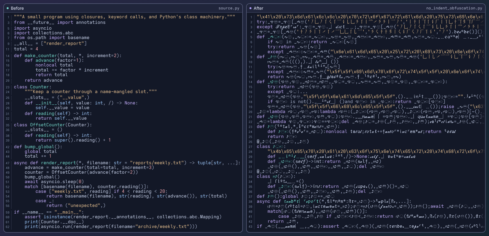

# Obfusbaker v3.0

Obfusbaker is a Python obfuscator. It masks identifiers with Unicode glyphs, encodes literals, and minifies the source. It also shuffles independent declarations and rewrites branches using native Python control flow. By default it adds irregular indentation and spacing. The output is a standalone Python file.

## Usage

```sh
python -m pip install -r requirements.txt
python obfusbaker.py examples/telemetry/source.py -o obfuscated.py
python obfuscated.py
```

Use `--no-indent` for regular indentation and `--keep NAME` to preserve a name that callers depend on. Run `python obfusbaker.py --help` for all options.

Each folder in [examples](examples/) contains the original program and its generated output.



## Slowdowns

Median runtime including Python startup over 21 runs per build on CPython 3.13.15.

| Example | Original | Obfuscated |
| --- | ---: | ---: |
| Generators | 9.3 ms | 10.1 ms (1.08×) |
| Telemetry (200,000 readings) | 29.4 ms | 50.0 ms (1.70×) |
| N-Queens (10 queens) | 107.2 ms | 286.9 ms (2.68×) |

As a rough guide, budget 0–15% extra runtime for scripts dominated by I/O or library calls. Tight Python loops with frequent attribute access or comparisons can take 1.5–3× as long.

## Development

Development is not active. I only intend to update this project when needed.

---

## Copyright and License
© [Vinyzu](https://github.com/Vinyzu/)

[GNU GPL](https://choosealicense.com/licenses/gpl-3.0/)

(Commercial Usage is allowed, but source, license and copyright has to made available. Obfusbaker does not provide and Liability or Warranty)

---

## Thanks to

[SvenSkiTheSource](https://github.com/Svenskithesource) (For sharing his Obfuscating Knowledge)

---


[](https://discordapp.com/users/935224495126487150)
[](https://ko-fi.com/vinyzu)
